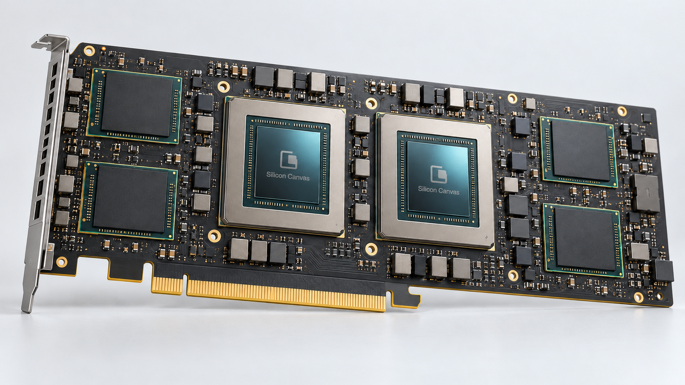

<p align="center">
  
</p>

<h1 align="center">Silicon Canvas</h1>

<p align="center"><strong>看见架构，清晰呈现</strong></p>

<p align="center">
  <a href="https://jiale-wangOwO.github.io/silicon-canvas/">网页演示版</a> ·
  <a href="https://github.com/jiale-wangOwO/silicon-canvas/releases/latest">下载 MCP</a> ·
  <a href="docs/mcp.md">接入指南</a>
</p>

Silicon Canvas 是面向芯片架构师的 **AI 绘图方案工具**。把自然语言中的设计内容与表达目标，转换成适合 Image Gen 的提示词、必要的结构参考和可继续修改的源规格，覆盖工程架构、算法数据流、状态与时序，以及系统插画和产品渲染。

设计事实、阅读目的与视觉表现分别处理，让同一份设计既能用于技术文档，也能用于方案介绍和产品展示。你可以用中文描述，新图默认使用英文标签。

## Let your agent set it up

把下面这段话发给支持本地 MCP 的 Agent：

```text
Hi! Please install https://github.com/jiale-wangOwO/silicon-canvas for me and get the MCP server running in this agent. When ready, give me a short list of the figures it can help me create and one example request to try.
```

## 安装 MCP

### 下载发布包

从 [v0.7.0 Release](https://github.com/jiale-wangOwO/silicon-canvas/releases/latest) 获取安装包。Windows 用户可下载 `silicon-canvas-mcp-windows-x64.zip`，解压完整目录，无需另装 Python。按包内 `MCP-CONFIG.json` 配置宿主，将 command 替换为 `silicon-canvas-mcp.exe` 的绝对路径，并保留相邻的 `_internal` 目录。

macOS、Linux 或需要 Python 环境的用户，可以使用 Release 中的 wheel 或从源码安装。

### 从源码安装

需要 **Python 3.11+**。先获取源码：

```sh
git clone https://github.com/jiale-wangOwO/silicon-canvas.git
cd silicon-canvas
```

Windows PowerShell：

```powershell
.\scripts\install-mcp.ps1 -PackagePath .
```

macOS / Linux：

```sh
bash scripts/install-mcp.sh .
```

安装器创建独立环境，并输出 `mcp-config.json` 和 `codex-mcp.toml`。把对应配置添加到宿主的 MCP 设置，重新加载服务即可；安装器不会改写现有宿主配置。服务入口为 `silicon-canvas-mcp`，通过 STDIO 由宿主启动。

使用本地 wheel 时，把安装命令中的源码目录参数替换为 wheel 路径。完整安装、客户端配置与故障排查见 [MCP 指南](docs/mcp.md)。

## 开始画图

安装后直接向 Agent 描述内容与用途，例如：

> 用 Silicon Canvas 做一张 GPU 架构总览，讲清主机接口、命令处理、计算簇、共享缓存与显存之间的关系。用于架构介绍，不展开执行单元内部。用图片生成工具画出来，再根据实际成图继续调整。

也可以要求算法依赖、协议状态、周期交互、封装剖切或完整板卡产品展示，不必先选分类。需要时在描述里指定视角、背景、材质、配色和详略。

默认流程是 **描述 → 宿主模型整理源事实 → MCP 编译 → Image Gen → 看图改进**。在 Codex 等支持 MCP 的 Agent 中，语义理解使用宿主现有模型，无需另配语义模型 API Key；实际生图使用宿主可用的图片工具。

工具会说明参考图的用途：工程图使用配套结构底稿，算法依赖图通常只需提示词，产品渲染的取景参考则是可选的。详见 [MCP 工作流](docs/mcp.md#agent-调用流程)。

## 实际作品

下面两张实际生成图展示算法依赖与完整板卡两种表达；板卡图在生成后加入了 Silicon Canvas 标志。更多作品见 [网页演示版的精选展示](https://jiale-wangOwO.github.io/silicon-canvas/#showcaseTitle)。

| 算法数据流 | 产品渲染 |
| --- | --- |
|  |  |

## 当前能力

| 表达 | 适合的内容 |
| --- | --- |
| **工程图** | 系统架构、微架构、硬件数据路径、算法依赖、状态机与时序交互 |
| **系统示意** | 功能分区、共享资源、系统组成与主要连接，兼顾结构解释和空间表现 |
| **商业渲染** | 芯片封装、板卡、服务器和机柜等产品主体，随用途安排镜头、材质、光照和标注 |

- **自然输入，自动安排。** 从描述理解用途、形式、详略与画幅；需要时直接指定视觉要求。信息不足时提供带明确假设的参考方案。
- **源事实与画面分开。** 保留模块、数量、归属、条件和关系，再选择本图的阅读范围；完整源规格随绘图包交接。
- **模型与编译解耦。** MCP 使用宿主模型整理内容，Web 连接所选语义服务，两者复用同一套编译核心。
- **支持继续修改。** 通过自然反馈调整方案，导出提示词、参考和源规格，便于 Agent 接续与核对。

生成图片仍可能出现文字、箭头或数量错误，需要实际查看并迭代；概念渲染不等同于真实版图、CAD 或制造资料。能力和验证边界见 [表达方式](docs/scenes.md) 与 [验证说明](docs/validation.md)。

共享核心与设计说明见 [项目架构](docs/architecture.md)、[系统设计](docs/system-design.md)。

## 网页演示版

打开 [在线演示](https://jiale-wangOwO.github.io/silicon-canvas/)，连接自己的 DeepSeek 或兼容服务，描述想画的内容并生成提示词。形式、用途和配色等默认自动安排，需要时展开“自定义”；随后复制提示词或下载绘图包，交给图片工具。


Web 可托管在 GitHub Pages 等静态服务，编译在浏览器 Worker 中运行。模型请求由浏览器直接发往你选择的服务，API Key 仅保存在当前页面内存；接口需允许浏览器 CORS。使用、本地预览和部署见 [Web 指南](docs/web.md)，数据处理见 [隐私说明](docs/privacy.md)。

## 参与贡献

欢迎贡献通用绘图策略、Agent/Web 体验、可复现的问题与可公开示例。提交问题时请附输入、实际结果和复现步骤；图形策略改动应兼顾不同主题与结构，避免只对单张展示图调优。开发、测试和分发物构建见 [贡献指南](CONTRIBUTING.md)。

## 许可证与安全

原创代码采用 [MIT](LICENSE) 许可。随包字体与其他资源遵循各自许可，见 [第三方资源](docs/third-party.md)。厂商和论文原图的版权不属于项目 MIT 许可，参考原图不随发行包分发。

请勿把 API Key 或未获授权的内部设计放入公共 Issue；漏洞报告方式见 [安全说明](SECURITY.md)。
