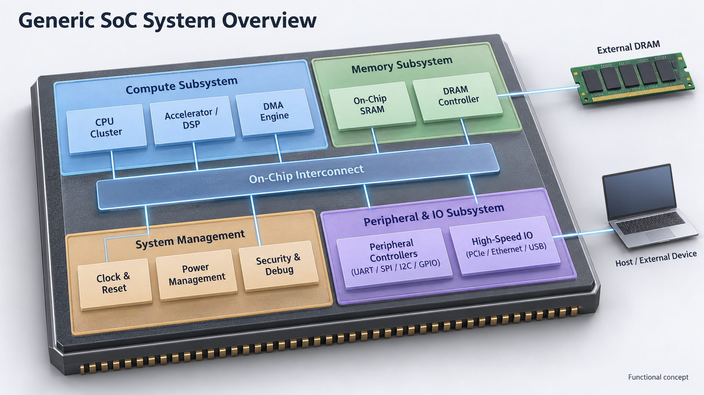
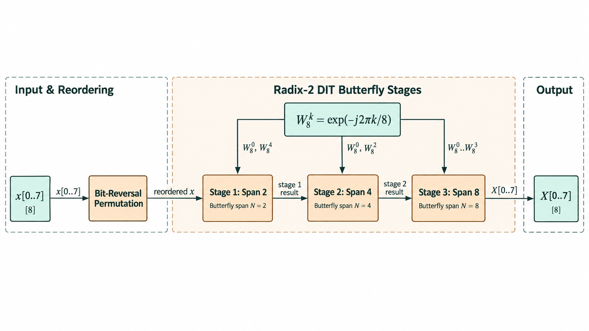
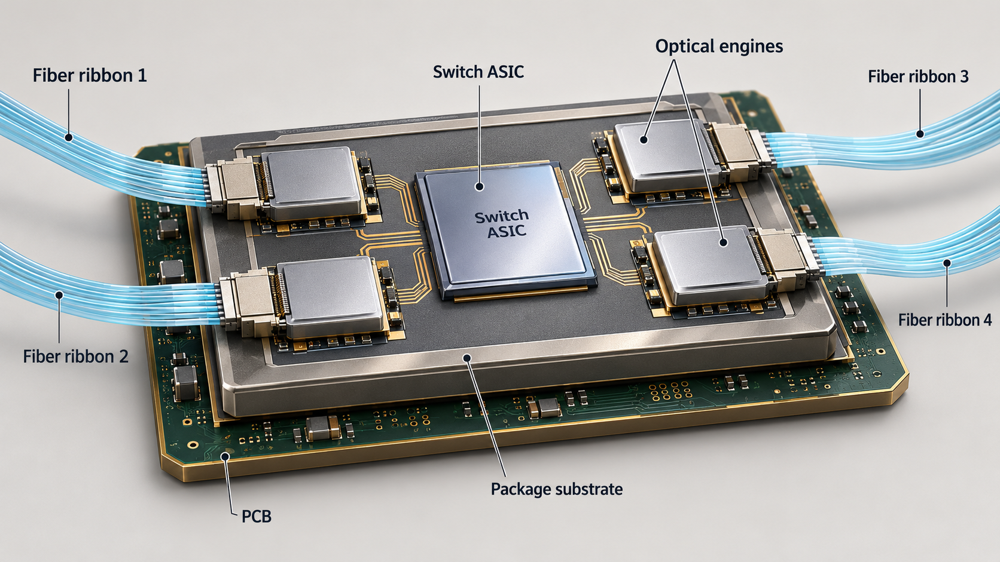
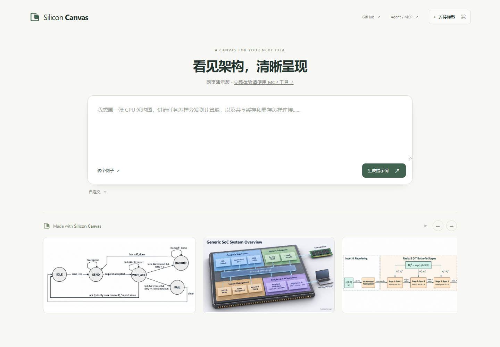

<p align="center">
  
</p>

<h1 align="center">Silicon Canvas</h1>

<p align="center"><strong>看见架构，清晰呈现</strong></p>

<p align="center">
  <a href="https://jiale-wangOwO.github.io/silicon-canvas/">网页演示版</a> ·
  <a href="#安装-codex-插件">安装 Codex 插件</a> ·
  <a href="docs/mcp.md">接入指南</a>
</p>

**让 AI 画出好看的架构图，更画出清楚的设计。**

Silicon Canvas 帮助 AI 更稳定地生成结构清晰、布局有序、风格协调的专业芯片图，适合技术文档、论文、架构评审与产品展示。

让 AI 画图少一点碰运气，减少反复试提示词的时间。从系统架构、算法数据流到产品渲染，都可以描述需求、生成图片，再通过自然反馈继续打磨。你可以用中文描述，新图默认使用英文标签。

## 实际作品

三种任务，三种表达。以下均为实际生成结果。

| SoC 架构概览 | 算法数据流 | 产品渲染 |
| --- | --- | --- |
| [](web/assets/render-examples/functional-soc.png) | [](web/assets/generalization-20261018/06-signal-fft.png) | [](web/assets/aesthetic-20261022/08-optical-io.png) |

更多作品见 [网页演示版的精选展示](https://jiale-wangOwO.github.io/silicon-canvas/#showcaseTitle)。

## Let your agent set it up

把下面这段话发给你的 Agent：

```text
Hi! Please install https://github.com/jiale-wangOwO/silicon-canvas for me. In Codex, install it as a plugin so it appears in the plugin list; in another agent, set up its MCP server. Verify the tools work, then give me a short list of how to use it and one example request.
```

## 安装 Codex 插件

Codex 用户推荐安装插件：它将绘图 Skill、MCP 工具与 Silicon Canvas 的名称和 Logo 一起提供，可以在插件列表中找到并启用。

需要 **Python 3.11+**，并能在终端运行 `python`。使用支持插件的 Codex：

```sh
codex plugin marketplace add jiale-wangOwO/silicon-canvas
codex plugin add silicon-canvas@silicon-canvas
```

在插件列表的 **Silicon Canvas** 来源中找到 **Silicon Canvas**。首次使用会自动准备独立的本机运行环境，后续调用复用缓存；无需再手动添加同名 MCP。宿主需要提供图片生成工具才能产出最终图像。

更新插件来源后，可通过插件管理界面重新安装或更新。插件固定使用随包记录的后端版本，避免调用时悄悄切换到不同的绘图规则。详细说明见 [接入指南](docs/mcp.md)。

## 其他 Agent：安装 MCP

### 下载发布包

从 [v0.7.0 Release](https://github.com/jiale-wangOwO/silicon-canvas/releases/latest) 获取安装包。Windows 用户可下载 `silicon-canvas-mcp-windows-x64.zip`，解压完整目录，无需另装 Python。按包内 `MCP-CONFIG.json` 配置宿主，将 command 替换为 `silicon-canvas-mcp.exe` 的绝对路径，并保留相邻的 `_internal` 目录。

macOS、Linux 或需要 Python 环境的用户，可以使用 Release 中的 wheel 或从源码安装。

### 从源码安装

需要 **Python 3.11+**。先获取源码：

```sh
git clone https://github.com/jiale-wangOwO/silicon-canvas.git
cd silicon-canvas
```

Windows PowerShell：

```powershell
.\scripts\install-mcp.ps1 -PackagePath .
```

macOS / Linux：

```sh
bash scripts/install-mcp.sh .
```

安装器创建独立环境，并输出 `mcp-config.json` 和 `codex-mcp.toml`。把对应配置添加到宿主的 MCP 设置，重新加载服务即可；安装器不会改写现有宿主配置。

使用本地 wheel 时，把安装命令中的源码目录参数替换为 wheel 路径。完整安装、客户端配置与故障排查见 [MCP 指南](docs/mcp.md)。

## 开始画图

在支持 MCP 和图片生成的 Agent 中，安装后直接描述内容与用途，例如：

> 用 Silicon Canvas 做一张 GPU 架构总览，讲清主机接口、命令处理、计算簇、共享缓存与显存之间的关系。用于架构介绍，不展开执行单元内部。用图片生成工具画出来，再根据实际成图继续调整。

也可以要求算法依赖、协议状态、周期交互、封装剖切或完整板卡产品展示，不必先选分类。需要时在描述里指定视角、背景、材质、配色和详略。

使用流程是 **描述内容与用途 → Agent 调用 Silicon Canvas 安排绘图 → 图片工具生成 → 看图反馈、继续调整**。

看过图片后，可以直接告诉 Agent：“计算簇按两行排，突出共享缓存”“主路径再清楚一点”或“这张用于产品介绍，减少内部细节”。需要保留的内容、想改变的地方，都可以用平常的话说明。

完整使用说明见 [MCP 指南](docs/mcp.md)。

## 当前能力

| 表达 | 适合的内容 |
| --- | --- |
| **工程图** | 系统架构、微架构、硬件数据路径、算法依赖、状态机与时序交互 |
| **系统示意** | 功能分区、共享资源、系统组成与主要连接，兼顾结构解释和空间表现 |
| **商业渲染** | 芯片封装、板卡、服务器和机柜等产品主体，随用途安排镜头、材质、光照和标注 |

- **结构有层次。** 区分系统组成、重复单元与共享资源，让读者看懂模块的归属和主次。
- **布局有主线。** 围绕要解释的关系安排位置与连线，让架构组织、数据流向或机制步骤更容易跟随。
- **视觉贴合用途。** 技术文档重清晰，方案介绍重整体，产品展示重主体与质感；布局、详略和表现方式一起考虑。
- **用自然反馈打磨。** 不必先选分类或填完表单，先说想法，再按实际图片调整。需要时可直接指定配色、画幅和细节。

成图中的文字、箭头和数量仍需查看与调整，概念渲染也不替代真实版图或制造资料。更多能力与适用范围见 [表达方式](docs/scenes.md) 和 [验证说明](docs/validation.md)。

## 网页演示版

打开 [网页演示版](https://jiale-wangOwO.github.io/silicon-canvas/)，连接自己的 DeepSeek 或兼容服务，描述需求并生成提示词，再交给图片工具。形式、用途和配色等默认自动安排，需要时展开“自定义”。希望由 Agent 连续完成绘图与反馈调整，请使用 MCP。



API Key 仅保存在当前页面内存，请求直接发往你选择的服务。使用与服务兼容性见 [Web 指南](docs/web.md)，数据处理见 [隐私说明](docs/privacy.md)。

## 参与贡献

欢迎贡献通用绘图策略、Agent/Web 体验、可复现的问题与可公开示例。提交问题时请附输入、实际结果和复现步骤；图形策略改动应兼顾不同主题与结构，避免只对单张展示图调优。开发、测试和分发物构建见 [贡献指南](CONTRIBUTING.md)。

## 许可证与安全

原创代码采用 [MIT](LICENSE) 许可。随包字体与其他资源遵循各自许可，见 [第三方资源](docs/third-party.md)。厂商和论文原图的版权不属于项目 MIT 许可，参考原图不随发行包分发。

请勿把 API Key 或未获授权的内部设计放入公共 Issue；漏洞报告方式见 [安全说明](SECURITY.md)。
